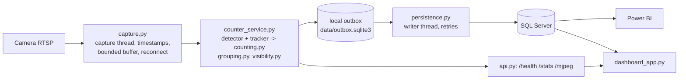

# GAP1 → Bake Oven anode handover counter

Counts anodes leaving the Green Anode Plant (GAP) on the GAP1 conveyor towards
the Bake Oven, using a fixed camera over the belt. GAP and Bake Oven have
disputed how many anodes were handed over; this system provides an objective,
time-stamped and auditable count.

The detector finds the 4 stub holes of each anode (YOLOv8m, `best.pt`, class
`Hole`); a tracker follows them; a hole is counted when it crosses the counting
line, and holes are grouped into anodes. Every count, every period in which the
belt could not be observed, and every rejected crossing is stored in SQL Server,
so the GAP and Bake Oven figures can be reconciled with evidence.

## Contents

1. [Project phases at a glance](#1-project-phases-at-a-glance)
2. [Phase 1: the original system](#2-phase-1-the-original-system)
3. [Phase 2: what was added, why, and what it does better](#3-phase-2-what-was-added-why-and-what-it-does-better)
4. [File-by-file guide](#4-file-by-file-guide)
5. [Behaviour changes when upgrading from Phase 1](#5-behaviour-changes-when-upgrading-from-phase-1)
6. [Results measured so far](#6-results-measured-so-far)
7. [How it works](#7-how-it-works)
8. [Install, database, configure, run](#8-install-database-configure-run)
9. [Replay, calibration and validation](#9-replay-calibration-and-validation)
10. [What the tables mean (for reconciliation)](#10-what-the-tables-mean-for-reconciliation)
11. [Tests](#11-tests)
12. [Still open](#12-still-open)

---

## 1. Project phases at a glance

| Phase | What it is | Where |
|---|---|---|
| **Phase 1** | The system as originally built: trained hole detector, one FastAPI service doing capture + detection + counting + SQL writes, SQL tables, Streamlit page, Power BI report. | commit `77fb086` |
| **Discovery audit** | Independent review of Phase 1 against the plant requirements; produced a defect register (D1-D20) and a prioritised plan. No code changed. | review report |
| **Phase 2** | Implementation of that plan, one problem at a time, each with tests and measurements on `Video1.mp4` with the real model. | commits `6f368a2` → `d114872` and later |

Phase 2 in one paragraph: counting no longer stops or loses events when SQL
Server has a problem; daily totals survive midnight and restarts; the camera is
read on its own thread so counts cannot fall progressively behind the belt;
every period in which the belt could not be observed (camera loss, slow
processing, service down, fumes) is recorded; holes whose detection weakens
while crossing are still counted, and weak crossings are recorded instead of
vanishing; a new anode-grouping method that keeps each anode record tied to
one physical anode runs alongside the old one for comparison; and replay,
scoring and ground-truth tools make every change measurable.

---

## 2. Phase 1: the original system

What existed (commit `77fb086`):

| Part | Phase 1 implementation |
|---|---|
| Model | `best.pt`: YOLOv8m fine-tuned with Ultralytics 8.4.11 (2026-02-04), 1 class `Hole`, image size 512. Validation: precision 0.926, recall 0.751, mAP50 0.842, mAP50-95 0.603. Dataset not in the repository. |
| Service | `service_app.py` (308 lines): one background thread opened the RTSP stream, ran `model.track()` (ByteTrack), counted holes crossing `LINE_Y`, turned every 4th hole into an anode, wrote each event to SQL Server synchronously, and JPEG-encoded every frame for `/mjpeg`. |
| Database | `sql_schema.sql`: `AnodeCountDaily`, `HoleCrossingEvents`, `spUpsertAnodeDaily`. `AnodeEvents` was used by the service and by Power BI but not defined in the repository. |
| Dashboards | `dashboard_app.py` (Streamlit) read `AnodeCountDaily`; Power BI (`Anode_Counting_Handover.pbix`) counted `AnodeEvents` rows by shift, hour and day. |
| Footage | `Video1.mp4`: 19.3 s clip, re-encoded and letterboxed (source ~20 fps up-converted to 30 fps). |

Problems found by the audit (IDs used throughout this README):

| ID | Problem in Phase 1 |
|---|---|
| D1 | One SQL error ended the counting thread; the API kept serving a frozen picture and old numbers, and nothing reported it. |
| D2 | Counters were never reset at midnight: every day's total after the first included all earlier days. |
| D3 | A restart reset the counters to zero and overwrote the day's total in `AnodeCountDaily`. |
| D4 | "Every 4th hole = 1 anode": starting mid-anode, or one missed or extra hole, shifted every later anode record. |
| D5 | The tracker never received low-confidence detections, and a fixed 0.80 gate ignored weaker ones, so a hole whose confidence dipped while crossing (fumes) was missed without trace. |
| D6 | Camera reading, detection, SQL and JPEG encoding ran in one loop: any slow step made counts fall further and further behind; stalls were not recorded. |
| D7 | No buffering, no retry, no protection against duplicate rows: a database outage lost events. |
| D8 | `AnodeEvents` and the Power BI shift logic are not defined in the repository. |
| D9 | Streamlit and Power BI read different tables and could disagree; Power BI silently excludes 2026-04-08/09. |
| D10 | Nothing stopped a second copy of the service from counting the same camera twice. |
| D11 | The model cannot be reproduced from the repository (dataset and training run missing). |
| D12 | No representative footage (fumes, maximum speed) for validation. |
| D13 | Any detection anywhere in the picture could count; `LINE_X1`/`LINE_X2` were only drawn. |
| D14 | `LastEventTime` in `AnodeCountDaily` was overwritten with NULL every few seconds. |
| D15 | Event times were processing time, not capture time; local and UTC times were mixed. |
| D16 | No indexes for per-day queries; any "frame deletion" job lives outside the repository. |
| D17 | Every frame was JPEG-encoded at full resolution even with nobody watching; `/mjpeg` re-sent the same image ~33 times per second. |
| D18 | Unpinned dependencies; no CUDA build of torch specified; `lap` (needed by the tracker) missing. |
| D19 | Security hygiene: open API port, `TrustServerCertificate=yes`, local paths in notebooks. |
| D20 | Counted track ids were kept in memory forever. |

---

## 3. Phase 2: what was added, why, and what it does better

Each item lists the problem it solves, what was added, why it was done this
way, what is better than Phase 1, how it was verified, and the files involved.

### 3.1 Testable counting core and offline replay (foundation)

| | |
|---|---|
| **Problem before** | All logic sat inside one 308-line loop tied to the camera, the GPU and SQL Server. No change could be tested, and no recorded footage could be replayed through the production logic. |
| **What was added** | Counting logic moved to pure-Python modules; a validated settings module; a replay tool that runs the production code on a video file, every frame, without SQL. |
| **Why** | Every later fix needs proof that it changes only what it should. The refactor was made first and kept behaviour identical, so its correctness could be proven on its own. |
| **What is better** | Changes are tested in seconds without camera or database; footage can be replayed and compared between versions; configuration mistakes are reported at startup, all at once, instead of silently changing counting. |
| **Verified by** | A test runs the original loop body (copied from `77fb086`) and the new modules on 40 randomized scenarios (misses, weak detections, id switches, jitter): identical results. |
| **Files** | `counting.py`, `config.py`, `detector.py`, `pipeline.py`, `overlay.py`, `replay.py`, `tests/test_counting.py`, `tests/test_config.py`, `tests/test_replay.py`, `tests/sim.py` · commit `6f368a2` |

### 3.2 Event delivery that cannot block or lose counts (D1, D7)

| | |
|---|---|
| **Problem before** | SQL writes ran inside the counting thread without error handling. One database error stopped counting while the page still looked alive; events during an outage were lost. |
| **What was added** | Every event is first written to a local SQLite outbox (milliseconds, survives crashes). A background writer delivers the outbox to SQL Server and retries with growing waits until it succeeds. Each event has a unique id (`EventUid`), so a retry never creates a duplicate row. The counting loop runs under a supervisor that restarts it after any error. `/health` reports problems. |
| **Why** | Counting must never depend on the database being available, and a retry after an unclear failure must be safe. |
| **What is better** | A database outage, restart or schema problem no longer stops counting or loses events; they are delivered when SQL Server is back. Failures are visible in `/health` instead of silent. One bad row cannot block the rest (it is set aside as a "dead letter" and reported). |
| **Verified by** | Tests: delivery in order with no loss or duplicates across failures; counting continues through a SQL outage and through a pipeline exception, and all events arrive exactly once afterwards. Real service with no database reachable: kept counting, `/health` said why, clean shutdown kept all queued events. |
| **Files** | `persistence.py`, `sql_client.py`, `counter_service.py`, `api.py`, `service_app.py`, `sql_migrations/001_event_uid.sql` · commit `ab5d31d` |

### 3.3 Daily totals that survive midnight and restarts (D2, D3, D14, D15)

| | |
|---|---|
| **Problem before** | `AnodeCountDaily` was overwritten from in-memory counters that were never reset at midnight and were reset to zero on restart. `LastEventTime` was overwritten with NULL. Event times were processing time. |
| **What was added** | A stored procedure (`spRefreshAnodeDaily`) recomputes a day's row from the event tables. The service keeps totals per plant-local date and, at startup, restores today's totals from SQL plus not-yet-delivered local events. Each event stores plant-local time (unchanged column) and the same instant in UTC (new column). |
| **Why** | A total derived from the events can never disagree with them, whatever happens to the process. Keeping the local-time columns unchanged keeps Power BI's shift and date logic working. |
| **What is better** | Totals roll over correctly at midnight, a restart keeps the day's total, late delivery after an outage lands on the right day, and `LastEventTime` is correct. If SQL is unreachable at startup, the service says it restored from local data only. |
| **Verified by** | Tests crossing plant midnight with an injected clock (events split correctly across the two dates), restart and restore tests, late-delivery and retry tests. The T-SQL was reviewed but not executed (no SQL Server in the test environment). |
| **Files** | `counting.py` (`DailyTally`), `counter_service.py`, `persistence.py`, `sql_client.py`, `sql_migrations/002_daily_totals_from_events.sql` · commit `3ee4a87` |

### 3.4 Camera read on its own thread; every unobserved period recorded (D6)

| | |
|---|---|
| **Problem before** | One loop read the camera and did everything else, so a slow step made frames queue and counts lag further and further behind. `CAP_PROP_BUFFERSIZE` and `flags;low_delay` had no effect; a stalled stream blocked for 30 s; nothing recorded when the belt was not being watched. |
| **What was added** | A capture thread that owns the camera connection, stamps every frame with its capture time, reconnects with backoff, and hands frames over through a small buffer (`CAPTURE_BUFFER_FRAMES`). A counting-gap ledger (`dbo.CountingGaps`) records every interval in which frames were not processed often enough, with the reason: `SOURCE_DISCONNECTED`, `SOURCE_STALL`, `PROCESSING_GAP`, `PIPELINE_RESTART`, `SERVICE_DOWN`. Explicit RTSP open/read timeouts. |
| **Why** | Short hiccups should not lose frames, but sustained overload must not build up delay; when frames are skipped, the counter must say so rather than silently miss anodes. While testing, `fflags;nobuffer` was found to discard all video up to the next keyframe at every (re)connect, so it was removed. |
| **What is better** | Delay is bounded instead of growing; every event carries its capture time and processing lag; camera drops, stalls, slow processing and downtime are written to the ledger, so a missing anode can be explained. The removed option had cost 158 frames (5.3 s) of `Video1.mp4` at every open. |
| **Verified by** | Capture tests (order, bounded backlog, hiccup absorbed, reconnect); gap tests for every reason with exact durations; regression test decoding all 579 frames of `Video1.mp4` with the service's options. Live test (video served as a real-time network stream, real model): capture kept 30 fps while delay stayed flat and skipped periods were recorded. |
| **Files** | `capture.py`, `counter_service.py`, `config.py`, `sql_client.py`, `sql_migrations/003_counting_gaps.sql` · commit `d0c7185` |

### 3.5 Holes counted on the evidence of their whole track (D5, D13, D20)

| | |
|---|---|
| **Problem before** | `conf=0.35` kept low-confidence detections from the tracker (Ultralytics' tracking default is 0.10 because the tracker needs them), and a fixed 0.80 gate ignored every weaker detection. A hole whose detection weakened while crossing was never counted and left no record. Any detection anywhere could count. Counted track ids were never released. |
| **What was added** | "Track evidence" counting (`COUNT_EVIDENCE=track`): every tracked detection moves the hole's track, and a crossing counts when the track has at least `COUNT_MIN_HITS` (2) detections at or above `COUNT_MIN_CONF` (0.80) at any time. Crossings that never reach that evidence are stored as rejected crossings (`dbo.RejectedHoleCrossings`). Only crossings between `LINE_X1` and `LINE_X2` count. Track memory is released when a track ends. Legacy behaviour stays available (`COUNT_EVIDENCE=frame`). |
| **Why** | Same evidence strength as before (two confident detections), but the confident detections no longer have to fall exactly on both sides of the line. Weak crossings must be visible for investigation, not lost. |
| **What is better** | Holes are counted through brief confidence dips, with the time of the frame in which they crossed; nothing that crossed disappears without a record; detections outside the hole lane cannot count; memory stays bounded. |
| **Verified by** | Simulation with holes that stay weakly detected past the line: legacy gate 68.6 %, track evidence 100 %, never more holes than physically passed. `Video1.mp4`, clear and with synthetic veils up to 0.85: both modes 13/13 (no regression). Heavy pulsed veil 0.90: track evidence 5/13 vs legacy 4/13 (one hole that crossed inside the veil was followed and confirmed afterwards). |
| **Files** | `counting.py`, `pipeline.py`, `counter_service.py`, `overlay.py`, `config.py`, `sql_client.py`, `sql_migrations/004_rejected_crossings.sql` · commit `2d36d91` |

### 3.6 Anode grouping by belt geometry, in shadow mode (D4)

| | |
|---|---|
| **Problem before** | Every 4th counted hole became an anode. On `Video1.mp4` (which starts mid-anode) all 3 anode records mixed holes of two physical anodes and were logged ~2.2 s late. With missed holes the anode count drops by a quarter anode per missed hole. |
| **What was added** | A structural grouper. When a hole is on the counting line, the holes ahead of it sit at whole-pitch distances along the belt, and the image distance maps to pitches the same way at every crossing (projective model fitted to the 1- and 2-pitch distances). The grouper reads each hole's position within its anode afresh at every crossing (neighbouring hole, then the pattern of holes and gaps ahead, then the step from the previous hole), so an error cannot spread to later anodes. Each anode record carries holes seen, slots and a status: `CONFIRMED`, `PARTIAL` or `UNCERTAIN`. It runs alongside the legacy method (`ANODE_GROUPING=modulo` stays the default) and its records go to `dbo.AnodeGroupingShadow`. |
| **Why** | Anode records must correspond to physical anodes to serve as handover evidence. Shadow mode lets the plant compare both methods on real production before switching, without changing any count. |
| **What is better** | A start mid-anode or a missed hole affects only that anode's record, which says how many holes were seen; the anode is still counted as long as one of its holes was seen. Belt speed and stops do not matter; partially seen anodes close when the next hole arrives, never on a timer. |
| **Verified by** | `Video1.mp4`, real model: structural 4 of 4 records each one physical anode with correct slots; legacy 0 of 3. Learned spacing 64.9 / 108.5 px matches a manual frame measurement (65 / 110 px); with spacing configured, each record is emitted the moment its last hole crosses. Simulation: with 5 / 10 / 20 % of holes missed, structural 100 / 99.5 / 99.3 % pure with all anodes counted; legacy 47 / 36 / 19 % pure with 12 / 17 / 26 % fewer anodes. No merged or split anodes with up to 40 % detection flicker. |
| **Files** | `grouping.py`, `counting.py`, `pipeline.py`, `counter_service.py`, `replay.py`, `evaluate.py`, `config.py`, `sql_client.py`, `sql_migrations/005_anode_grouping.sql` · commit `dbd725f` |

### 3.7 Low-visibility (fume) periods recorded (new finding)

| | |
|---|---|
| **Problem before** | Found by stress testing: under a heavy veil the detector does not degrade gradually; it stops detecting altogether (13/13 holes at a 0.85 veil, 0/13 at 0.90). Processing continues, so such a period looked exactly like an empty belt and the missed anodes left no trace. |
| **What was added** | A visibility monitor: contrast in a band around the counting line, compared with a clear-view baseline, combined with whether any hole is detected confidently. Low contrast and no confident detection for 2 s = `LOW_VISIBILITY` counting gap; low contrast with holes still detected = `REDUCED` (shown in `/health` only). |
| **Why** | Better counting logic cannot recover holes the detector cannot see; the honest answer is to record that the belt could not be observed. Edge sharpness was tested and rejected: it collapses at a light veil while counting still works, which would cause constant false alarms. |
| **What is better** | Fume periods in which anodes cannot be seen are stored with start, end and severity, and shown in `/health` and the dashboard; an empty belt is not flagged. |
| **Verified by** | `Video1.mp4` with a heavy pulsed veil: gaps recorded at 0-3, 6-9 and 12-15 s, matching the veil windows; 7 of 8 missed holes fall inside a recorded gap. Moderate veil (0.75): no gaps, 13/13 counted. |
| **Files** | `visibility.py`, `counter_service.py`, `pipeline.py`, `replay.py`, `config.py`, `tests/test_visibility.py` · commit `605c6e6` |

### 3.8 Live preview only when someone is watching (D17)

| | |
|---|---|
| **Problem before** | Every frame was copied, annotated and JPEG-encoded at full resolution inside the counting loop, even with no viewer; each viewer received the same image ~33 times per second. |
| **What was added** | The preview is encoded only while at least one `/mjpeg` viewer is connected, at `PREVIEW_MAX_FPS` (5), downscaled to `PREVIEW_WIDTH` (960), and each image is sent once. The dashboard shows video only when asked. |
| **Why** | Preview work competed with counting for CPU, and repeated images wasted network bandwidth. |
| **What is better** | No preview cost when nobody watches; bounded cost and bandwidth when someone does. |
| **Verified by** | Test: no encoding without viewers, capped rate with a viewer, stops when the viewer leaves. |
| **Files** | `counter_service.py`, `api.py`, `service_app.py`, `config.py` · commit `3588afd` |

### 3.9 Only one counter per camera (D10)

| | |
|---|---|
| **Problem before** | Running the service with two workers, or a forgotten second copy, would open a second camera stream and write every event twice. |
| **What was added** | An operating-system file lock next to the outbox; a second instance refuses to start and names the running one. |
| **Why** | Double counting must be impossible by construction, not by convention. |
| **What is better** | A second instance exits immediately with a clear message; the lock is released automatically if the owning process dies. |
| **Verified by** | Cross-process test; real service started twice: the second exited with code 3 naming the first instance's pid, the first kept running. |
| **Files** | `instance_lock.py`, `service_app.py`, `tests/test_instance_lock.py` · commit `3588afd` |

### 3.10 Reproducible installation (D18)

| | |
|---|---|
| **Problem before** | Unpinned dependencies; installing on Windows gives a CPU-only torch (this caused the `device=0` errors in the notebooks); `lap` missing, so the tracker tries to download it at runtime, which fails on an offline server. |
| **What was added** | Version ranges, `lap`, instructions to install the CUDA build of torch first and to record a lock file after a successful install; `requirements-dev.txt` for tests. |
| **Why** | A reinstall or a new server must produce a working system without internet access at runtime. |
| **What is better** | Known-good version ranges, no runtime downloads, documented and recordable environment. |
| **Verified by** | The `lap` failure was reproduced in the test environment and fixed by the requirement. |
| **Files** | `requirements.txt`, `requirements-dev.txt` · commit `3588afd` |

### 3.11 Dashboard on the same data as Power BI, with evidence (D9, D16)

| | |
|---|---|
| **Problem before** | The Streamlit page read `AnodeCountDaily` (wrong after restarts and midnight), charted hole crossings, never refreshed, and streamed full-rate video to every open page; Power BI counts a different table. |
| **What was added** | Day figures from `AnodeEvents` (the table Power BI counts) using indexed time ranges, shown next to the evidence: time the belt was not observable, rejected crossings, anode status, the grouping comparison and a list of counting gaps. A live section reads `/health` and `/stats` and refreshes automatically. New database objects are used only when the migrations have been applied. |
| **Why** | Two dashboards must not show two different truths, and a count is only trustworthy if its gaps are visible next to it. |
| **What is better** | Dashboard and Power BI agree; operators see current service health, how long the belt was not observable, and which anodes were fully confirmed; works before and after the migrations; video only on request. |
| **Verified by** | Data-layer tests on migrated and original schemas; page rendered with Streamlit's test runner on both schemas and with the service unreachable; live section checked against the real running service. |
| **Files** | `dashboard_app.py`, `dashboard_data.py`, `tests/test_dashboard.py` · commit `d114872` |

### 3.12 Measurement tools and ground truth (validation)

| | |
|---|---|
| **Problem before** | No ground truth and no way to score counting accuracy; only the model's validation metrics, which do not measure counting. |
| **What was added** | `evaluate.py` scores a replay against ground truth: hole recall, precision and timing, and anode grouping purity (does each anode record contain holes of exactly one physical anode). A provisional ground-truth file for `Video1.mp4` derived from a model-free intensity analysis. `replay.py` options to compare counting modes and grouping methods, report calibration values, and stress-test with a synthetic veil. |
| **Why** | Counting accuracy, not mAP, is the business outcome; every change must be compared on the same footage. |
| **What is better** | Every claim in this README is reproducible with one replay and one evaluate command. |
| **Verified by** | `tests/test_evaluate.py`, `tests/test_replay.py`; used for all real-footage results above. |
| **Files** | `evaluate.py`, `replay.py`, `validation/video1_ground_truth.csv` · commits `2d36d91`, `dbd725f`, `605c6e6` |

### 3.13 Not changed in Phase 2 (on purpose)

* `best.pt`, the training/testing notebooks, `Video1.mp4`, the Power BI file and
  `sql_schema.sql` are unchanged (they are evidence and the production baseline).
* Legacy behaviour remains selectable: `COUNT_EVIDENCE=frame`, `ANODE_GROUPING=modulo` (default).
* Existing database columns, rows and `spUpsertAnodeDaily` are untouched; the
  Phase 1 service still runs against a migrated database (rollback path).

### 3.14 Fixes from code review

Automated review of the pull requests found the following; each fix is in the
pull request that introduced the code and has a test.

| Problem found | Fix | File |
|---|---|---|
| `COUNT_MIN_CONF=nan` passed validation and silently stopped all counting. | `nan`/`inf` rejected at startup. | `config.py` |
| While the outbox is unwritable, events wait in a bounded memory queue; when it was full the oldest were dropped without a trace. | Dropped events counted, logged as critical and shown in `/health` (`events_lost`). | `counter_service.py` |
| An event written to SQL just before a stop, but not yet marked as sent, was counted twice in today's restored totals. | One idempotent delivery batch runs before the restore. | `service_app.py` |
| A daily-row refresh pending at a stop was forgotten. | Days with events delivered in the last 24 h are refreshed again at startup. | `persistence.py`, `sql_client.py`, `service_app.py` |
| On OpenCV older than 4.5.4 the RTSP timeout properties are missing and the camera never opened. | Properties looked up safely; FFmpeg defaults used when missing. | `capture.py` |
| A hole whose evidence completed after the next hole had qualified was numbered after it, which could attribute it to the wrong anode (modulo) or split an anode (structural). | Holes numbered in crossing order (a qualified crossing waits at most `TRACK_STALE_FRAMES` for an earlier pending one). Video1.mp4 results unchanged. | `counting.py`, `replay.py` |
| With `SOURCE=file` a low-visibility period still open at stop was not recorded. | Last processed frame time kept for every source. | `counter_service.py` |
| Two cameras with separate outboxes in one folder shared one lock file. | Lock file per outbox (`<OUTBOX_PATH>.lock`). | `service_app.py` |
| The dashboard hid the anode evidence line when no anode had a status (default modulo grouping). | `NOT ASSESSED` shown. | `dashboard_app.py` |
| Scoring: closest-pair-first matching could leave valid hole matches unused; an anode whose holes matched no true hole was scored as mixed. | Maximum matching, then least timing error; such anodes reported as `unassessed`. Scores of all earlier replays unchanged. | `evaluate.py` |

---

## 4. File-by-file guide

Status: **New** (added in Phase 2), **Rewritten**, **Modified**, **Unchanged**.

### Service runtime

| File | Status | What it does | Phase 2 change and what is better |
|---|---|---|---|
| `service_app.py` | Rewritten (308 → 118 lines) | Entry point: loads settings, wires capture, counting, outbox, writer and API; single-instance lock; `python service_app.py` runs one worker. | All logic moved to focused modules; startup no longer crashes on a machine without CUDA; `API_HOST`/`API_PORT` are now used; corrected FFmpeg options; restores today's totals before counting. |
| `counter_service.py` | New | The supervised counting loop: takes frames, runs detection/counting/grouping/visibility, writes events to the outbox, records counting gaps, keeps per-day totals, produces `/health` and `/stats`. | Replaces the unprotected loop: errors restart the pipeline instead of ending counting (D1); capture-time timestamps and lag (D15); gaps recorded (D6); totals per date (D2, D3); preview only for viewers (D17). |
| `capture.py` | New | Camera thread: reads frames, stamps capture time, small buffer, reconnects with backoff, explicit timeouts; FFmpeg options without `nobuffer`. | Counting can no longer fall progressively behind the belt; stalls and reconnects become measurable gaps; no video discarded at reconnect (D6). |
| `api.py` | New | HTTP endpoints: `/health` (200 ok/degraded, 503 down), `/stats`, `/mjpeg`, `/`. | Health checks did not exist; `/mjpeg` sends each image once and only encodes while watched. |
| `instance_lock.py` | New | OS file lock so only one counter runs per outbox/camera. | Prevents double counting (D10). |
| `detector.py` | New | Wraps Ultralytics YOLO + ByteTrack and returns plain detections. | Isolates torch/Ultralytics so the rest is testable without a GPU. |
| `overlay.py` | New | Draws the counting line, boxes (blue = confident, grey = weak) and today's totals on the preview. | Shows which detections the counter relies on. |

### Counting logic

| File | Status | What it does | Phase 2 change and what is better |
|---|---|---|---|
| `counting.py` | New | Line-crossing counter (track evidence or legacy), rejected crossings, per-day tallies, legacy every-4th-hole grouper. | Holes counted through confidence dips, weak crossings recorded, ROI gate, bounded memory (D5, D13, D20); totals per plant date (D2, D3). Legacy mode kept and proven identical to Phase 1. |
| `grouping.py` | New | Structural anode grouping by belt geometry; spacing model and calibration. | Anode records tied to physical anodes with a status (D4); runs in shadow mode by default. |
| `visibility.py` | New | Contrast-plus-detection visibility monitor at the counting line. | Fume periods in which anodes cannot be seen are recorded instead of looking like an empty belt. |
| `pipeline.py` | New | Per-frame processing shared by service and replay; builds counter, groupers and visibility monitor from settings. | Guarantees replay runs exactly the production logic. |
| `config.py` | New | Reads and validates all settings; reports every error together; secrets kept out of logs. | Typos and missing values fail at startup instead of silently changing counting; `COUNT_DIRECTION` required. |

### Persistence and database

| File | Status | What it does | Phase 2 change and what is better |
|---|---|---|---|
| `persistence.py` | New | Local SQLite outbox and background writer with retries, dead letters and pruning; small state store (last processed frame). | No event lost in a database outage; counting never waits for SQL (D1, D7); downtime detectable at next start. |
| `sql_client.py` | Rewritten (82 → 282 lines) | SQL Server access: one reused connection with timeouts, idempotent inserts, daily refresh, day counts, schema check, error classification. | New connection per call and unhandled errors replaced; duplicates impossible; clear message when a migration is missing. |
| `sql_schema.sql` | Unchanged | Original Phase 1 tables (fresh installs). | Kept as the baseline; changes are in the migrations. |
| `sql_migrations/001_event_uid.sql` | New | `EventUid` + unique indexes; creates `AnodeEvents` on fresh installs. | Safe retries without duplicates (D7). |
| `sql_migrations/002_daily_totals_from_events.sql` | New | `spRefreshAnodeDaily`, UTC columns, per-day indexes. | Daily totals derived from events (D2, D3); indexed queries (D16); unambiguous times (D15). |
| `sql_migrations/003_counting_gaps.sql` | New | `CountingGaps` table, `ProcessingLagMs` columns. | Unobserved periods and lag stored (D6, fumes). |
| `sql_migrations/004_rejected_crossings.sql` | New | `RejectedHoleCrossings` table. | Weak crossings kept for investigation (D5). |
| `sql_migrations/005_anode_grouping.sql` | New | `GroupingMethod`, `HolesSeen`, `CountStatus` on `AnodeEvents`; `AnodeGroupingShadow` table. | Evidence behind each anode; shadow comparison (D4). |

### Tools

| File | Status | What it does | Phase 2 change and what is better |
|---|---|---|---|
| `replay.py` | New | Runs the production counting code on a video file (every frame, no SQL); writes holes, rejected crossings, anodes (counted and shadow), visibility periods, timings and calibration values; optional synthetic veil and annotated video. | Baseline and every change measurable offline; calibration of spacing and visibility from production footage. |
| `evaluate.py` | New | Scores a replay against ground truth: hole recall/precision/timing and anode grouping purity. | Counting accuracy measured directly (not model mAP). |
| `validation/video1_ground_truth.csv` | New | Provisional ground truth for `Video1.mp4` (13 hole crossings, 3 boundaries) from a model-free analysis. | Enables scoring; must be confirmed by a person before acceptance decisions. |

### Dashboard

| File | Status | What it does | Phase 2 change and what is better |
|---|---|---|---|
| `dashboard_app.py` | Rewritten (73 → 152 lines) | Streamlit page: live service status, day figures with evidence, hourly chart, gaps, grouping comparison, optional video. | Same numbers as Power BI, evidence next to every count, auto-refresh, no unwanted video streaming (D9, D17). |
| `dashboard_data.py` | New | Dashboard queries; uses new tables only when present; gap time clipped to the day. | Testable, works before and after migrations. |

### Configuration and dependencies

| File | Status | What it does | Phase 2 change and what is better |
|---|---|---|---|
| `.env.example` | Modified | Template of every setting with explanations. | Documents all new settings and calibration values; comments moved onto their own lines (some loaders do not strip inline comments); recommends `CONF_THRES=0.10`; notes firewalling the API port. |
| `requirements.txt` | Modified | Runtime dependencies. | Version ranges, `lap` added, CUDA torch instructions, lock-file step (D18). |
| `requirements-dev.txt` | New | Test dependencies. | One-step test setup. |
| `.gitignore` | Modified | Ignored files. | Adds the local outbox folder `data/` and test caches. |
| `README.md` | New | This document. | Explains the project, Phase 2, every file, operation and validation. |

### Tests (192 in total, `python -m pytest tests`)

| File | Tests | What it proves |
|---|---|---|
| `tests/test_counting.py` | 85 | New counter equals the Phase 1 loop (40 randomized scenarios); line-crossing rules; track evidence recovers weak crossings without over-counting (30 scenarios); rejected crossings; ROI gate; memory release; holes numbered in crossing order when evidence completes out of order. |
| `tests/test_grouping.py` | 29 | Structural grouping: clean train, start mid-anode, one missed hole in each position, belt stop, flicker (20 scenarios), spacing model, cold-start calibration. |
| `tests/test_service.py` | 17 | Counting through SQL outages and pipeline errors, midnight roll-over, restart restore, every gap reason, capture-time events, preview gating, `/health` status codes; events lost from a full pending queue reported; open low-visibility period closed at stop for file sources. |
| `tests/test_sql_client.py` | 12 | Idempotent inserts, duplicate/data/transient error handling, schema check, daily refresh for late deliveries, grouping evidence columns; startup delivery settles an event committed just before a stop. |
| `tests/test_config.py` | 13 | Defaults, required settings, all errors reported together, legacy modes selectable, secrets not printed, `nan`/`inf` rejected. |
| `tests/test_persistence.py` | 10 | Outbox order and durability, retries without loss or duplicates, dead letters, per-day counts, upgrade of older outbox files, recently delivered days. |
| `tests/test_capture.py` | 9 | Frame order, bounded backlog, hiccup absorption, reconnect, open failures, all 579 frames of `Video1.mp4` decoded with the service's options; RTSP opens on OpenCV builds without timeout properties. |
| `tests/test_visibility.py` | 7 | Clear view and empty belt OK, reduced contrast with detections not a gap, blind period becomes one gap, short blips ignored, baseline not dragged down by long fumes. |
| `tests/test_dashboard.py` | 5 | Day queries on migrated and original schemas; page renders on both and with the service unreachable; anodes without assessment shown as NOT ASSESSED. |
| `tests/test_evaluate.py` | 3 | Misses, extras and mixed anodes counted correctly; matching maximises matches before timing error; anodes without matched holes reported as unassessed. |
| `tests/test_replay.py` | 1 | Replay writes holes, anodes and summary from a video file. |
| `tests/test_instance_lock.py` | 1 | A second process cannot start; lock released when the owner dies. |
| `tests/sim.py`, `tests/conftest.py`, `tests/__init__.py` | - | Belt simulator (holes, anodes, misses, weak detections, flicker) and test setup. |

### Data and artefacts (unchanged)

| File | What it is |
|---|---|
| `best.pt` | Production detector weights (YOLOv8m, class `Hole`). |
| `Video1.mp4` | 19.3 s sample clip (re-encoded; used for all real-footage tests). |
| `YOLOMODEL.ipynb`, `YOLO_TESTING.ipynb`, `test.ipynb` | Phase 1 training/testing notebooks (the training cell shown did not produce `best.pt`; outputs contain local paths). |
| `Anode_Counting_Handover.pbix` | Power BI report (counts `AnodeEvents`). |
| `Vedanta Aluminium Virtual Background - Copy 2.jpg` | Image used in the Power BI report. |

---

## 5. Behaviour changes when upgrading from Phase 1

Check these before deploying Phase 2 over a Phase 1 installation:

| Change | Effect | To keep Phase 1 behaviour |
|---|---|---|
| `COUNT_DIRECTION` is required | Service refuses to start without it (a wrong direction used to count nothing silently). | Set it (`up` for GAP1). |
| `COUNT_EVIDENCE` defaults to `track` | Holes are counted on whole-track evidence. | `COUNT_EVIDENCE=frame`. |
| `CONF_THRES` default 0.10 | Only if `.env` does not set it; existing files with 0.35 keep 0.35. | Keep `CONF_THRES=0.35`. |
| `VIDEO_PATH` alone no longer switches to file input | `SOURCE=file` is required for file input, so a leftover `VIDEO_PATH` cannot replace the camera. | - |
| `OPENCV_BUFFERSIZE` no longer used | It never had an effect with the FFmpeg backend. | - |
| Migrations 001-005 required | Until applied, events wait in the outbox and `/health` names the missing objects. | Apply the migrations first. |
| Local data folder `data/` | Holds the outbox and the instance lock; back it up with the server. | `OUTBOX_PATH`. |
| One process per camera | A second instance exits. | - |

---

## 6. Results measured so far

All on `Video1.mp4` with the real model unless stated; ground truth is provisional.

| Measure | Phase 1 | Phase 2 |
|---|---|---|
| Holes counted (clear) | 13 / 13 | 13 / 13 |
| Anode records corresponding to one physical anode | 0 / 3 | 4 / 4 (structural, shadow) |
| Anode record emitted after its last hole | ~2.2 s late (and mixed) | at the same frame (calibrated spacing) |
| Video lost at stream open | 158 frames (5.3 s) | 0 frames |
| Heavy pulsed veil (0.90): holes counted | 4 / 13 (legacy gate) | 5 / 13 (track evidence) |
| Heavy pulsed veil (0.90): missed holes explained by a recorded gap | 0 | 7 of 8 |
| Moderate veil (0.75): false gaps | n/a | none (13 / 13 counted) |
| SQL Server outage | counting stops, events lost | counting continues, no loss, no duplicates (tests) |
| Midnight / restart | totals wrong / erased | correct (tests) |
| Simulation, weak detection past the line | 68.6 % of holes | 100 % |
| Simulation, 10 % of holes missed: anodes counted / pure records | 83 % / 36 % | 100 % / 99.5 % |

Timing figures measured in the test environment came from a shared CPU, not
the plant's L4 GPU, and are not production performance.

---

## 7. How it works



* The counting loop never waits for SQL Server. Events go to a local SQLite
  outbox first and are delivered by a background writer that retries until it
  succeeds; every event has a unique id, so retries never create duplicates.
* Totals per day are derived from the event rows (`dbo.spRefreshAnodeDaily`),
  so restarts, midnight and late delivery after an outage cannot corrupt them.
* Whenever frames could not be processed often enough, the camera dropped, the
  service was down, or fumes made the belt unobservable, the interval is stored
  in `dbo.CountingGaps`. Missing anodes are therefore explainable.

---

## 8. Install, database, configure, run

### Install (server)

1. Python 3.11–3.13 and *Microsoft ODBC Driver 17 or 18 for SQL Server*.
2. Install the **CUDA** build of PyTorch for the server's driver first (plain
   `pip install torch` on Windows installs a CPU-only build):
   `pip install torch torchvision --index-url https://download.pytorch.org/whl/cu124`
3. `pip install -r requirements.txt`
4. After a successful replay test (below), record the exact versions:
   `pip freeze > requirements.lock.txt` and commit it.

### Database

Apply on a **test copy first**, in order:

| Script | Adds |
|---|---|
| `sql_schema.sql` | original tables (fresh installs only) |
| `sql_migrations/001_event_uid.sql` | `EventUid` + unique indexes (idempotent delivery); `AnodeEvents` on fresh installs |
| `sql_migrations/002_daily_totals_from_events.sql` | `spRefreshAnodeDaily`, UTC columns, indexes |
| `sql_migrations/003_counting_gaps.sql` | `CountingGaps`, `ProcessingLagMs` |
| `sql_migrations/004_rejected_crossings.sql` | `RejectedHoleCrossings` |
| `sql_migrations/005_anode_grouping.sql` | `GroupingMethod`, `HolesSeen`, `CountStatus`; `AnodeGroupingShadow` |

All migrations are additive and re-runnable; existing columns, rows and
`spUpsertAnodeDaily` are untouched, so the previous service version still
runs against a migrated database (rollback = redeploy the old code). The
service checks the schema on connect and reports missing objects in `/health`;
events wait safely in the outbox until the migration is applied.

`dbo.AnodeEvents` existed in production before these scripts but its DDL was
never in the repository: export it and compare with `001_event_uid.sql`.

### Configure

Copy `.env.example` to `.env`; every setting is documented there. Essentials:

* `COUNT_DIRECTION` (required), `LINE_Y`, `LINE_X1`/`LINE_X2` (narrow to the hole lane).
* `COUNT_EVIDENCE=track` (default) vs `frame` (legacy), `CONF_THRES=0.10`.
* `ANODE_GROUPING=modulo` (legacy, default) until the shadow comparison supports `structural`.
* Calibration values from a replay of clear production footage (see below):
  `HOLE_SPACING_PX`, `HOLE_SPACING_2_PX`, `VISIBILITY_BASELINE`.

### Run

```
python service_app.py
```

Run **exactly one** counter process per camera (a file lock next to the outbox
makes a second one exit). To run it as a Windows service use a service wrapper
of your choice pointed at that command, with automatic restart.

* `GET /health`: `ok` / `degraded` (HTTP 200) or `down` (HTTP 503), with frame
  age, lag, capture, visibility, SQL backlog and counting statistics. Use it
  for monitoring and automatic restarts.
* `GET /stats`: today's totals (plant-local date).
* `GET /mjpeg`: annotated live view, encoded only while someone watches.
  The API has no authentication: restrict `API_PORT` with the firewall.

Dashboard: `streamlit run dashboard_app.py` (set `SERVICE_URL` in `.env`).

---

## 9. Replay, calibration and validation

Replay runs the production counting code on a video file, every frame, without SQL:

```
python replay.py --video clip.mp4 --out runs/clip --env .env --save-video
python evaluate.py --replay runs/clip --truth validation/clip_ground_truth.csv
python evaluate.py --replay runs/clip --truth validation/clip_ground_truth.csv --anodes anodes_shadow.csv
```

* **Footage**: use native exports from the NVR/camera. Re-encoded or edited
  clips change frame rate and timing (`Video1.mp4` was re-encoded from ~20 fps
  to 30 fps with duplicated frames, and letterboxed).
* **Calibration**: from the replay `summary.json` of clear footage, copy
  `structural_spacing_px` → `HOLE_SPACING_PX` / `HOLE_SPACING_2_PX` and
  `visibility_contrast.p90` → `VISIBILITY_BASELINE`. Repeat if the camera moves.
* **Ground truth**: one row per hole crossing and anode boundary
  (`validation/video1_ground_truth.csv` shows the format). Annotate by stepping
  through the video; have GAP and Bake Oven agree on it.
* **Stress tests**: `--haze ALPHA[,PERIOD,DURATION]` adds a synthetic veil.
  It is a stand-in for fumes, not a substitute for real fume footage.

Proposed acceptance criteria (to be agreed with operations after the baseline
on real footage): zero duplicated anodes; every missed anode inside a recorded
counting gap or rejected crossing; anode grouping purity ≥ 99 %; event lag p95
≤ 2 s; no lost or duplicated events across a 10-minute SQL outage and a
service restart.

### Switching anode grouping to `structural`

Run with the default `modulo` for a representative period (shifts, batch
changes, belt stops, fumes) and compare `dbo.AnodeEvents` with
`dbo.AnodeGroupingShadow` against GAP/Bake records and ground-truthed footage.
Switch when structural is at least as accurate on counts and its `UNCERTAIN`
share is understood.

---

## 10. What the tables mean (for reconciliation)

| Table | Meaning |
|---|---|
| `AnodeEvents` | Counted anodes. `GroupingMethod`, `HolesSeen`, `CountStatus` (CONFIRMED / PARTIAL / UNCERTAIN; NULL = not assessed by the legacy method). Power BI counts this table. |
| `HoleCrossingEvents` | Counted holes (capture time local + UTC, confidence, lag). |
| `AnodeCountDaily` | Per-day totals, recomputed from the two tables above. |
| `CountingGaps` | Intervals the belt was not observed: `SOURCE_DISCONNECTED`, `SOURCE_STALL`, `PROCESSING_GAP`, `PIPELINE_RESTART`, `SERVICE_DOWN`, `LOW_VISIBILITY`. |
| `RejectedHoleCrossings` | Crossings without enough confident detections; not counted. |
| `AnodeGroupingShadow` | Anodes from the grouping method not used for counting; never in totals. |

Local time columns (`EventTime`, `AnodeTime`, gap times) are plant-local, as
before; the `...Utc` columns hold the same instants in UTC.

---

## 11. Tests

```
pip install -r requirements-dev.txt
python -m pytest tests
```

192 tests; see the table in section 4 for what each file proves.

---

## 12. Still open

These need plant data, plant access or decisions and were not addressed in Phase 2:

* **Validation on real production footage (D12)**: so far only `Video1.mp4`
  (19 s, 3 anodes, clear), simulation and a synthetic veil. Needed: native
  recordings at maximum belt speed, with real fumes, stops and batch changes,
  and agreed ground truth.
* **Thresholds derived from `Video1.mp4`**: `MAX_FRAME_GAP_MS`, spacing and
  visibility values; re-check on the production stream (its resolution and
  frame rate are not documented).
* **SQL scripts not yet executed** against a real SQL Server.
* **System of record (D8)**: export the production `AnodeEvents` DDL and the
  Power BI shift logic (`Anode_Shift`, `ReportDateAnode`) into the repository;
  explain or remove the excluded days 2026-04-08/09 in the day-wise chart (D9).
* **Model provenance (D11)**: archive the training dataset, `data.yaml` and
  training command for `best.pt`.
* **Frame/data deletion (D16)**: confirm whether any job on the server deletes
  rows; event rows are the audit evidence and should not be deleted.
* **Security (D19)**: firewall the API port; consider an encrypted SQL
  connection with certificate validation (`TrustServerCertificate=yes` is still
  used); clear notebook outputs before sharing the repository; confirm the
  Ultralytics AGPL-3.0 licence position.
* **Proximity sensor**: available at the conveyor; integrating it as an
  independent count needs work on the plant network.
