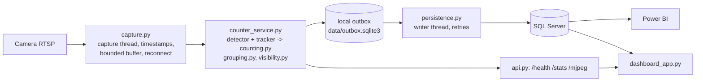

# GAP1 → Bake Oven anode handover counter

Counts anodes leaving the Green Anode Plant on the GAP1 conveyor from a fixed
camera. The detector finds the 4 stub holes of each anode (YOLOv8m, `best.pt`,
class `Hole`); a tracker follows them; a hole is counted when it crosses the
counting line, and holes are grouped into anodes. Every count, every period in
which the belt could not be observed, and every rejected crossing is stored in
SQL Server so the GAP and Bake Oven figures can be reconciled with evidence.

## How it works



* The counting loop never waits for SQL Server. Events go to a local SQLite
  outbox first and are delivered by a background writer that retries until it
  succeeds; every event has a unique id, so retries never create duplicates.
* Totals per day are derived from the event rows (`dbo.spRefreshAnodeDaily`),
  so restarts, midnight and late delivery after an outage cannot corrupt them.
* Whenever frames could not be processed often enough, the camera dropped, the
  service was down, or fumes made the belt unobservable, the interval is stored
  in `dbo.CountingGaps`. Missing anodes are therefore explainable.

| Module | Responsibility |
|---|---|
| `service_app.py` | Entry point, wiring, single-instance lock |
| `capture.py` | Camera thread, capture timestamps, bounded buffer, reconnect |
| `counter_service.py` | Supervised counting loop, events, gaps, health |
| `counting.py` | Line crossing (track evidence / legacy), daily tallies, legacy grouping |
| `grouping.py` | Anode grouping by belt geometry (structural) |
| `visibility.py` | Low-visibility (fume) detection |
| `persistence.py`, `sql_client.py` | Outbox, delivery, SQL access |
| `api.py` | `/health`, `/stats`, `/mjpeg` |
| `replay.py`, `evaluate.py` | Offline replay of footage and scoring against ground truth |
| `dashboard_app.py`, `dashboard_data.py` | Operator dashboard |

## Install (server)

1. Python 3.11–3.13 and *Microsoft ODBC Driver 17 or 18 for SQL Server*.
2. Install the **CUDA** build of PyTorch for the server's driver first (plain
   `pip install torch` on Windows installs a CPU-only build):
   `pip install torch torchvision --index-url https://download.pytorch.org/whl/cu124`
3. `pip install -r requirements.txt`
4. After a successful replay test (below), record the exact versions:
   `pip freeze > requirements.lock.txt` and commit it.

## Database

Apply on a **test copy first**, in order:

| Script | Adds |
|---|---|
| `sql_schema.sql` | original tables (fresh installs only) |
| `sql_migrations/001_event_uid.sql` | `EventUid` + unique indexes (idempotent delivery); `AnodeEvents` on fresh installs |
| `sql_migrations/002_daily_totals_from_events.sql` | `spRefreshAnodeDaily`, UTC columns, indexes |
| `sql_migrations/003_counting_gaps.sql` | `CountingGaps`, `ProcessingLagMs` |
| `sql_migrations/004_rejected_crossings.sql` | `RejectedHoleCrossings` |
| `sql_migrations/005_anode_grouping.sql` | `GroupingMethod`, `HolesSeen`, `CountStatus`; `AnodeGroupingShadow` |

All migrations are additive and re-runnable; existing columns, rows and
`spUpsertAnodeDaily` are untouched, so the previous service version still
runs against a migrated database (rollback = redeploy the old code). The
service checks the schema on connect and reports missing objects in `/health`;
events wait safely in the outbox until the migration is applied.

`dbo.AnodeEvents` existed in production before these scripts but its DDL was
never in the repository: export it and compare with `001_event_uid.sql`.

## Configure

Copy `.env.example` to `.env`; every setting is documented there. Essentials:

* `COUNT_DIRECTION` (required), `LINE_Y`, `LINE_X1`/`LINE_X2` (narrow to the hole lane).
* `COUNT_EVIDENCE=track` (default) vs `frame` (legacy), `CONF_THRES=0.10`.
* `ANODE_GROUPING=modulo` (legacy, default) until the shadow comparison supports `structural`.
* Calibration values from a replay of clear production footage (see below):
  `HOLE_SPACING_PX`, `HOLE_SPACING_2_PX`, `VISIBILITY_BASELINE`.

## Run

```
python service_app.py
```

Run **exactly one** counter process per camera (a file lock next to the outbox
makes a second one exit). To run it as a Windows service use a service wrapper
of your choice pointed at that command, with automatic restart.

* `GET /health`: `ok` / `degraded` (HTTP 200) or `down` (HTTP 503), with frame
  age, lag, capture, visibility, SQL backlog and counting statistics. Use it
  for monitoring and automatic restarts.
* `GET /stats`: today's totals (plant-local date).
* `GET /mjpeg`: annotated live view, encoded only while someone watches.
  The API has no authentication: restrict `API_PORT` with the firewall.

Dashboard: `streamlit run dashboard_app.py` (set `SERVICE_URL` in `.env`).

## Replay, calibration and validation

Replay runs the production counting code on a video file, every frame, without SQL:

```
python replay.py --video clip.mp4 --out runs/clip --env .env --save-video
python evaluate.py --replay runs/clip --truth validation/clip_ground_truth.csv
python evaluate.py --replay runs/clip --truth validation/clip_ground_truth.csv --anodes anodes_shadow.csv
```

* **Footage**: use native exports from the NVR/camera. Re-encoded or edited
  clips change frame rate and timing (`Video1.mp4` was re-encoded from ~20 fps
  to 30 fps with duplicated frames, and letterboxed).
* **Calibration**: from the replay `summary.json` of clear footage, copy
  `structural_spacing_px` → `HOLE_SPACING_PX` / `HOLE_SPACING_2_PX` and
  `visibility_contrast.p90` → `VISIBILITY_BASELINE`. Repeat if the camera moves.
* **Ground truth**: one row per hole crossing and anode boundary
  (`validation/video1_ground_truth.csv` shows the format). Annotate by stepping
  through the video; have GAP and Bake Oven agree on it.
* **Stress tests**: `--haze ALPHA[,PERIOD,DURATION]` adds a synthetic veil.
  It is a stand-in for fumes, not a substitute for real fume footage.

Proposed acceptance criteria (to be agreed with operations after the baseline
on real footage): zero duplicated anodes; every missed anode inside a recorded
counting gap or rejected crossing; anode grouping purity ≥ 99 %; event lag p95
≤ 2 s; no lost or duplicated events across a 10-minute SQL outage and a
service restart.

### Switching anode grouping to `structural`

Run with the default `modulo` for a representative period (shifts, batch
changes, belt stops, fumes) and compare `dbo.AnodeEvents` with
`dbo.AnodeGroupingShadow` against GAP/Bake records and ground-truthed footage.
Switch when structural is at least as accurate on counts and its `UNCERTAIN`
share is understood. Results so far: `Video1.mp4` 4/4 structural records
correspond to one physical anode each (legacy 0/3); in simulation structural
grouping stays ≥ 99 % pure with up to 20 % of holes missed, where legacy
grouping mixes most anodes and undercounts.

## What the tables mean (for reconciliation)

| Table | Meaning |
|---|---|
| `AnodeEvents` | Counted anodes. `GroupingMethod`, `HolesSeen`, `CountStatus` (CONFIRMED / PARTIAL / UNCERTAIN; NULL = not assessed by the legacy method). Power BI counts this table. |
| `HoleCrossingEvents` | Counted holes (capture time local + UTC, confidence, lag). |
| `AnodeCountDaily` | Per-day totals, recomputed from the two tables above. |
| `CountingGaps` | Intervals the belt was not observed: `SOURCE_DISCONNECTED`, `SOURCE_STALL`, `PROCESSING_GAP`, `PIPELINE_RESTART`, `SERVICE_DOWN`, `LOW_VISIBILITY`. |
| `RejectedHoleCrossings` | Crossings without enough confident detections; not counted. |
| `AnodeGroupingShadow` | Anodes from the grouping method not used for counting; never in totals. |

Local time columns (`EventTime`, `AnodeTime`, gap times) are plant-local, as
before; the `...Utc` columns hold the same instants in UTC.

## Tests

```
pip install -r requirements-dev.txt
python -m pytest tests
```

## Known limitations / open items

* Validated only on `Video1.mp4` (19 s, 3 anodes, clear) plus simulation and
  synthetic haze. Real production footage at maximum belt speed, with fumes,
  stops and batch changes is needed before trusting the numbers.
* `MAX_FRAME_GAP_MS`, spacing and visibility thresholds were derived from
  `Video1.mp4`; re-check them on the production stream (resolution and frame
  rate of the live stream are not documented).
* The T-SQL in `sql_migrations/` has not been executed in this environment.
* Power BI: shift definitions (`Anode_Shift`, `ReportDateAnode`) live in the
  report model, and the day-wise chart excludes 2026-04-08/09 without a note.
* A proximity sensor exists at the conveyor; integrating it as an independent
  count needs work on the plant network.
* The notebooks contain local Windows paths in their outputs; clear outputs
  before sharing the repository more widely. Ultralytics is AGPL-3.0: confirm
  licensing for production use.
